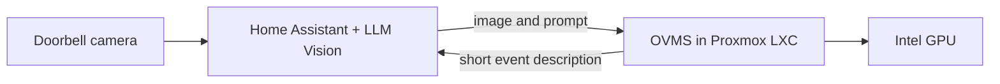

# OpenVINO Model Server for Proxmox

### Local vision AI for Home Assistant, served from an Intel GPU—inside a native Proxmox LXC.

This personal helper installs [OpenVINO Model Server (OVMS)](https://github.com/openvinotoolkit/model_server) and a ready-to-use vision-language model without Docker. The goal is straightforward: let Home Assistant send a camera image to a local model and get a short description back, without relying on a cloud vision API.

> This is an independent personal project, not an official Proxmox or Proxmox Community Scripts helper. It is hardware-specific and should be reviewed before running as root.

## What it sets up

- An unprivileged Ubuntu 24.04 LXC with OVMS 2026.4.0 installed as a native systemd service.
- Intel GPU render-device mapping from the Proxmox host (the Intel `renderD*` node is detected, not assumed).
- `OpenVINO/Qwen3-VL-4B-Instruct-int4-ov`, exposed as `qwen3-vl-4b` over an OpenAI-compatible API.
- **GPU only.** The service refuses to start with any device other than `GPU`, and the health check confirms the running server was started on the GPU. Nothing switches to CPU.
- A Proxmox-style interactive setup, tty1 root-console autologin, and an in-container `update` command.

The first service start downloads roughly 3.1 GB of model files. The default LXC sizing is 8 CPU cores, 16 GiB RAM, and a 48 GiB root disk with DHCP. Advanced Setup lets you choose the container ID, resources, storage, bridge, static IPv4, VLAN tag, and the domains OVMS may fetch image URLs from.

## How it fits together



## Quick start

Run on the Proxmox VE host as root. Inspect the script before executing it. Download a tagged release rather than `main` so you know exactly which version you reviewed:

```bash
curl -fL https://raw.githubusercontent.com/exelaguilar/proxmox-ovms-helper/v1.4.0/ovms-lxc-helper.sh -o /root/ovms-lxc-helper.sh
less /root/ovms-lxc-helper.sh
bash /root/ovms-lxc-helper.sh
```

The installer checks the host GPU, render node, Proxmox version, storage, and network configuration. It displays a plan for confirmation before creating a new container. If setup fails after container creation, it leaves that container in place for troubleshooting rather than deleting it.

Other modes, all run on the Proxmox host:

| Command | What it does |
| --- | --- |
| `bash ovms-lxc-helper.sh --check <CTID>` | Read-only report: helper version, configured and running device, GPU mapping, service state, model endpoint. Changes nothing. |
| `bash ovms-lxc-helper.sh --update <CTID>` | Snapshots the LXC, then runs its in-container `update` and GPU health check. |
| `bash ovms-lxc-helper.sh --repair <CTID>` | Snapshots the LXC, then reinstalls OVMS and the helper scripts. Keeps extra OVMS arguments and backs up every replaced file. |

**Installed with helper v1.2.x or earlier?** Those versions put CPU-fallback logic inside the container, and their `update` can still switch OVMS to CPU. Run `--check`, then `--repair`. See [Upgrading an existing container](INSTALL.md#upgrading-an-existing-container).

## Home Assistant

Use LLM Vision's **Custom OpenAI** provider and select it in the relevant action or blueprint. The endpoint is `http://<CT-IP>:8000/v1/chat/completions` for integrations that request a full endpoint, or `http://<CT-IP>:8000/v1` when the integration requests a base URL. The model name is `qwen3-vl-4b`; `openai` can be used as a dummy API key when required by the client.

If Home Assistant sends image **URLs** rather than inline base64 images, OVMS must be allowed to fetch from that host with `--allowed_media_domains`. Set it in Advanced Setup, or later in `/etc/ovms/ovms.env` (see [INSTALL.md](INSTALL.md#extra-ovms-arguments)).

OVMS does not enable authentication or TLS for this endpoint. Keep it on a trusted LAN or firewall port 8000 to Home Assistant. More setup details are in [Installation and operation](INSTALL.md).

## Tested GPU workaround

On one Intel Arrow Lake system (`8086:7d51`, reported as Intel Arc Graphics), the `VLM_CB` pipeline failed with `CL_OUT_OF_RESOURCES`, including with a single sequence. Switching the pipeline to `VLM` while keeping `--target_device GPU` enabled text and image inference, including a Home Assistant doorbell-image request. This is a tested workaround for that setup, not a confirmed root-cause fix for every Intel GPU or driver combination.

The tradeoff is that `VLM` does not use continuous batching, so it is less suited to high-concurrency serving. For a single Home Assistant camera workflow, the simpler pipeline has worked well. See [GPU troubleshooting and findings](GPU-TROUBLESHOOTING.md) for reproduction details, limitations, and a draft upstream report.

## Project notes

- [Installation and operation](INSTALL.md)
- [GPU troubleshooting and findings](GPU-TROUBLESHOOTING.md)
- [Changelog](CHANGELOG.md)
- [Helper script](ovms-lxc-helper.sh)
